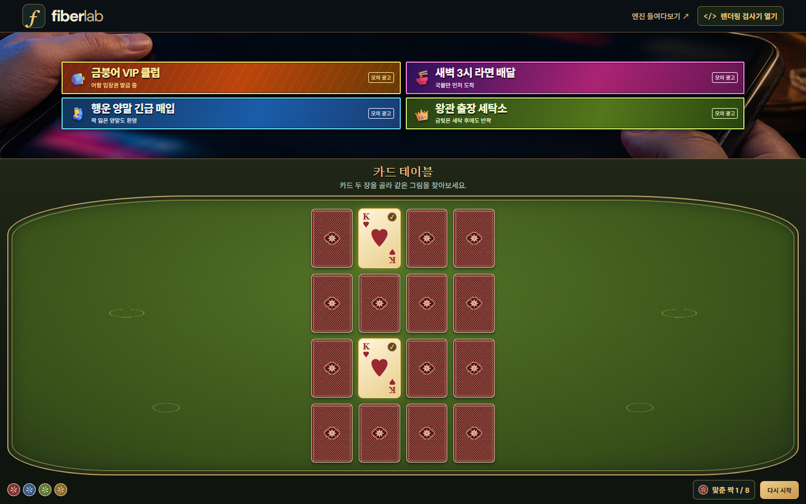
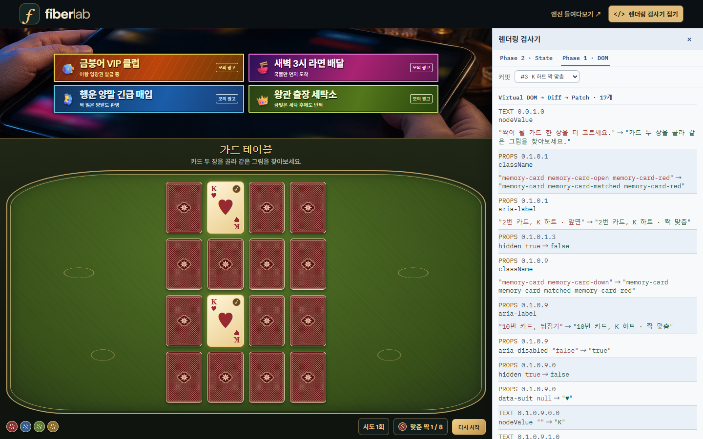

# Fiber Lab · Mini React

**카드 짝 맞추기를 하면서 Mini React가 상태를 실제 DOM에 반영하는 과정을 확인할 수 있는 Vanilla TypeScript 프로젝트입니다.**

4×4 카드에서 같은 카드 두 장을 찾고, 오른쪽 위 **렌더링 검사기**로 그 클릭의 커밋을 열어 보세요. **Phase 2** 탭에서 상태와 Props의 전후 값을, **Phase 1** 탭에서 실제 DOM에 적용한 Patch를 볼 수 있습니다. 두 탭은 같은 커밋을 보여줍니다.

[빠른 실행](#빠른-실행) · [Phase 2](#phase-2-상태와-hooks) · [Phase 1](#phase-1-virtual-dom과-dom-반영) · [4분 발표 순서](#4분-발표-순서)

[](docs/images/memory-game.png)

## 빠른 실행

개발과 CI 검증에는 Node.js 24를 사용합니다. Node.js 22를 사용한다면 22.12 이상이 필요합니다.

```bash
git clone https://github.com/kuk-hwan/mini-react-fiber-lab.git
cd mini-react-fiber-lab
npm ci
npm run dev
```

[http://127.0.0.1:5173](http://127.0.0.1:5173)에서 확인하세요. 브라우저는 `.ts` 파일을 직접 실행하지 않으므로 Vite가 개발 중에 JavaScript로 변환합니다. 배포할 때는 `dist/`의 컴파일된 정적 파일을 사용합니다.

```bash
npm run typecheck         # 소스·테스트·설정 strict 타입 검사
npm test                  # tsx + Node test runner + jsdom 단위·통합 테스트
npm run test:coverage     # 커버리지
npm run build             # 정적 결과물 dist/
npx playwright install chromium
npm run test:e2e          # 데스크톱 + 모바일 Chromium E2E
npm run preview           # 빌드 결과물 확인
```

기본 포트가 사용 중이면 `npm run dev -- --port 5174`로 바꾸세요. E2E는 5173 포트를 사용합니다. CI의 E2E는 Vite preview를 통해 `dist/` 결과물을 검증합니다.

## Phase 2 상태와 Hooks

캡처는 2번 카드를 먼저 뒤집고 같은 하트 K인 10번 카드를 고른 장면입니다. 카드 위치는 새 게임마다 달라질 수 있습니다. 오른쪽 위 **렌더링 검사기 열기 → Phase 2 · State**에서 `#3 · K 하트 짝 맞춤` 커밋의 상태와 자식 Props가 어떻게 바뀌었는지 볼 수 있습니다.

[](docs/images/memory-phase-2.png)

| 검사기 항목           | 변경 전 | 변경 후   |
| --------------------- | ------- | --------- |
| `open`                | `[2]`   | `[]`      |
| `matched`             | `[]`    | `[2, 10]` |
| `Card[2].appearance`  | `open`  | `matched` |
| `Card[10].appearance` | `down`  | `matched` |

루트 `GameBoard`가 `useState`로 카드 상태를 관리합니다. 두 번째 카드를 누르면 `setGame()` 한 번으로 `open`, `matched`, `move`가 들어 있는 게임 상태를 갱신합니다. 자식 `Card`는 `appearance` Prop의 값에 따라 앞면, 뒷면, 짝 맞춤 상태의 Virtual DOM을 반환합니다. 여러 상태 변경 요청을 모으는 배칭은 [추가 실험의 Hooks 작업 보드](#추가-실험)에서 확인할 수 있습니다.

`useMemo`는 카드의 클릭 함수를 재사용합니다. 서로 다른 카드를 고르면 DOM 반영 뒤 `useEffect`가 1.2초 타이머를 예약합니다. 검사기의 **커밋 목록**에서 타이머를 예약한 커밋과 두 카드가 다시 덮인 커밋을 각각 볼 수 있습니다. [게임 코드](src/demo/memory-game.ts)

## Phase 1 Virtual DOM과 DOM 반영

검사기를 **Phase 1 · DOM**으로 바꾸면 **같은 하트 K 짝 맞춤 커밋**의 실제 Patch 기록을 확인할 수 있습니다.

[](docs/images/memory-phase-1.png)

- **`PROPS`**는 두 카드의 `className`을 `memory-card-matched`가 포함된 값으로 바꾸고, 완료 표식과 접근성 라벨을 갱신합니다.
- **`TEXT`**는 카드 안내 문구나 하단의 맞춘 짝 수처럼 바뀐 텍스트를 반영합니다.
- **경로**는 변경된 노드가 Virtual DOM 트리의 어디에 있는지 나타냅니다. 카드 자리마다 같은 `key`를 사용하므로 뒤집은 뒤에도 기존 카드 버튼 DOM을 재사용합니다.

검사기는 커밋에서 수집한 실제 Patch 작업과 Virtual DOM의 전후 값을 표시합니다. 화면에 나온 16개는 **이 커밋의 논리적 Patch 작업 수**입니다. [Diff 코드](src/core/diff.ts) · [Patch 코드](src/core/patch.ts) · [검사기 코드](src/demo/game-inspector.ts)

## 4분 발표 순서

발표에서는 README 맨 위에서 출발해 **Phase 2 → Phase 1 → 구현의 중심** 순서로 내려가면 됩니다. 두 캡처는 같은 커밋이라 화면을 띄운 채 상태 변화와 DOM 반영을 연결해서 설명할 수 있습니다.

| 시간      | README에서 보여줄 곳                                              | 설명할 내용                                                                                             |
| --------- | ----------------------------------------------------------------- | ------------------------------------------------------------------------------------------------------- |
| 0:00–0:25 | 맨 위 게임 사진                                                   | 카드 한 번의 선택이 어떻게 화면 변경으로 이어지는지 보여주는 Mini React입니다.                          |
| 0:25–1:25 | [Phase 2 상태와 Hooks](#phase-2-상태와-hooks)                     | 오른쪽의 `matched [] → [2, 10]`과 카드의 `appearance` 값이 `matched`로 바뀐 줄을 가리킵니다.            |
| 1:25–2:30 | [Phase 1 Virtual DOM과 DOM 반영](#phase-1-virtual-dom과-dom-반영) | 같은 커밋에서 카드 클래스가 바뀌어 금색으로 표시되고, 맞춘 짝 수가 1로 바뀝니다.                        |
| 2:30–3:30 | [구현의 중심](#구현의-중심)                                       | 상태 변경 요청부터 Fiber의 컴포넌트 실행, Virtual DOM 생성, Diff·Patch까지 흐름도를 따라갑니다.         |
| 3:30–4:00 | [검증과 차별점](#검증과-차별점)                                   | 카드 버튼이 같은 DOM 객체로 유지되는지와, 다른 카드 두 장이 타이머로 다시 덮이는 동작을 테스트했습니다. |

## 구현의 중심

```text
사용자 이벤트 → setState queue
                    ↓
       FunctionComponent.update()
                    ↓
   Work-in-progress Fiber (child / sibling / return)
         함수 평가 + host Virtual DOM 생성
                    ↓
          공유 diffSteps() → 변경 계획
                    ↓
   동기 commit: patch() → hooks 확정 → effects
```

Fiber는 `child`, `sibling`, `return`으로 작업 위치를 기록합니다. 한 차례의 작업에 약 5ms를 할당하고, 남은 작업은 다음 차례에 이어갈 수 있습니다. 렌더링에서 새 Virtual DOM과 변경 계획을 완성한 뒤 커밋에서 `patch()`로 실제 DOM에 적용합니다.

카드 게임과 작업 보드는 `FunctionComponent`로 렌더링을 예약합니다. Fiber 엔진이 함수형 컴포넌트를 실행해 Virtual DOM을 만들고 `diffSteps()`와 `patch()`를 호출합니다. HTML 실험실은 편집된 DOM을 Virtual DOM으로 바꾼 뒤 `diff()`로 같은 비교 엔진을 실행하고 `patch()`로 반영합니다. 엔진과 데모는 strict TypeScript로 작성했고 UI 프레임워크나 런타임 npm 의존성 없이 동작합니다.

<details>
<summary>엔진 사용 예제 · Counter 컴포넌트</summary>

```ts
import { h, FunctionComponent, useState, useEffect, useMemo } from './src/core/index.ts';

function Label({ value }: { value: number }) {
  return h('strong', {}, value);
} // 자식 Hook 금지

function Counter() {
  const [count, setCount] = useState(0);
  const doubled = useMemo(() => count * 2, [count]);
  useEffect(() => {
    const previous = document.title;
    document.title = `count: ${count}`;
    return () => {
      document.title = previous;
    };
  }, [count]);
  return h('button', { onClick: () => setCount((n) => n + 1) }, h(Label, { value: doubled }));
}

const root = document.querySelector('#root');
if (!root) throw new Error('root 요소가 필요합니다.');
const app = new FunctionComponent(Counter).mount(root);
await app.whenIdle();
// app.update({ ...newProps });
// app.unmount();
```

</details>

## 추가 실험

| 화면                                            | 확인할 수 있는 것                                                                          |
| ----------------------------------------------- | ------------------------------------------------------------------------------------------ |
| [HTML 실험실](http://127.0.0.1:5173/#lab)       | DOM → VNode 변환, HTML 편집과 Patch, 이전·다음 스냅샷 복원                                 |
| [Hooks 작업 보드](http://127.0.0.1:5173/#hooks) | 작업 추가 실행 기록, `useMemo`·`useEffect`, `+3`의 요청 3개를 커밋 한 번으로 처리하는 배칭 |

작업 보드에서 **`+3 한 번에`**를 누르면 `setBatchCount(n => n + 1)`이 세 번 호출됩니다. 엔진은 이미 예약한 렌더링에서 세 요청을 순서대로 계산하고, 최종값을 한 번 커밋합니다. 배칭 카드에 **상태 변경 요청 3개 · 커밋 1회**가 표시됩니다. [작업 보드 코드](src/demo/board.ts) · [배칭 테스트](tests/hooks.test.ts)

## 소스 안내

| 경로                                                       | 역할                                            |
| ---------------------------------------------------------- | ----------------------------------------------- |
| `src/core/vnode.ts`                                        | h, DOM → VNode, key 매칭                        |
| `src/core/dom.ts`                                          | DOM 생성, 속성·이벤트·폼·SVG 반영               |
| `src/core/diff.ts`                                         | 5가지 핵심 변경 계획, 중복 key 검증, generator  |
| `src/core/patch.ts`                                        | 계획을 실제 DOM에 적용, key 이동·정체성 보존    |
| `src/core/fiber.ts`                                        | FunctionComponent, 작업 루프, commit, lifecycle |
| `src/core/hooks.ts`                                        | 호출 순서 기반 슬롯, 상태 큐, effect, memo      |
| `src/lab/`                                                 | Phase 1 편집기, HTML 제한, 이력                 |
| [`src/demo/memory-game.ts`](src/demo/memory-game.ts)       | 카드 상태, 순수 Card 컴포넌트, 다시 덮는 타이머 |
| [`src/demo/game-inspector.ts`](src/demo/game-inspector.ts) | 커밋 이력, 상태·Props 전후, 실제 Patch 기록     |
| [`src/demo/memory-table.css`](src/demo/memory-table.css)   | 화면 전체를 채우는 테이블과 오른쪽 검사기 배치  |
| `src/demo/board.ts`                                        | Phase 2 루트와 순수 자식 컴포넌트               |
| `tests/`                                                   | 단위·통합·회귀 테스트 및 E2E                    |
| `docs/ARCHITECTURE.md`                                     | 핵심 코드 설명, 설계 판단, 학습 질문            |
| `docs/REQUIREMENTS.md`                                     | 과제 요구사항과 코드·검증 연결                  |

공통 타입은 `src/core/types.ts`, DOM 유틸리티는 `src/shared/dom.ts`에 있습니다. `tsconfig.json`은 strict 타입 검사, `vite.config.ts`는 개발 서버와 정적 빌드를 설정합니다. 구성과 타입 설계는 [TypeScript 가이드](docs/TYPESCRIPT.md)를 참고하세요.

## 검증과 차별점

- **41개 단위·통합·회귀 테스트**: 실제 DOM 객체의 동일성까지 검증
- **컴파일 전용 타입 계약**: 잘못된 상태 값·updater 반환형·자식 props·effect 반환값·Patch 계획을 타입 검사에서 거부
- 120개의 결정적 무작위 key 배열 변경을 새 렌더링 결과와 대조
- 초기화·이벤트 교체·폼 값·SVG·주석·공백·빈 트리·중복 key 검사
- Hook 순서 위반, render 중 DOM 불변, render 도중 들어온 상태 변경, unmount와 이전 setter 검사
- GitHub Actions CI에서 E2E 4개 시나리오를 데스크톱과 모바일 Chromium 프로필로 각각 실행
- 카드 뒤집기와 짝 맞춤, `useEffect` 타이머, 검사기 탭 전환과 실제 Patch 기록을 브라우저에서 확인

`PATCH OPS`는 이벤트 리스너 교체를 포함한 논리적 Patch 작업 수입니다. 하나의 subtree CREATE도 한 작업으로 셉니다. 실제 브라우저 layout/paint 횟수나 생성한 전체 DOM 노드 수와 같지 않습니다. 시간 수치는 로컬 측정이며 React와의 성능 비교 결과가 아닙니다.

## 범위와 한계

교육용 Fiber 구현이며 React와 API/동작이 완전히 호환되지는 않습니다.

- Hook과 상태는 **루트에서만** 사용합니다. 컴포넌트는 하나의 VNode나 문자열·숫자를 반환할 수 있습니다. `null`, `undefined`, 불리언은 빈 출력으로 처리합니다. Fragment·Portal은 미지원입니다.
- Hook 호출 순서가 일정해야 합니다. 조건부 Hook의 종류·개수 변경은 오류로 처리합니다.
- Render는 협력적으로 양보하지만 단일 함수 호출, 넓은 형제 목록의 매칭, 동기 commit은 도중에 중단하지 않습니다.
- 효과는 커밋 중 `patch()`로 DOM을 수정한 뒤 동기 실행합니다. React의 passive effect/paint 타이밍이나 Strict Mode 재실행을 재현하지 않습니다.
- lanes, priority, Suspense, SSR/hydration, Error Boundary, Context, class component는 구현하지 않았습니다.
- key는 형제 사이에서 유일해야 합니다. unkeyed 항목은 위치로 매칭합니다. 이동은 정확한 결과와 DOM 재사용을 목표로 하며 전역 최소 이동 횟수는 보장하지 않습니다.
- HTML 실험실은 허용된 태그·속성만 다룹니다. script/iframe/inline handler/file input 등은 제외합니다. 일반 목적의 검증된 HTML sanitizer를 대체하는 라이브러리가 아닙니다.
- DOM 변경은 브라우저 기본 API로 처리합니다. 모든 DOM API, custom element, MathML, 임의 네임스페이스 속성을 지원하지 않습니다.
- Google Fonts는 선택적 시각 리소스입니다. 네트워크가 없으면 시스템 폰트로 실행됩니다.

참고한 원문과 실제 React와의 비교는 [설계 문서](docs/ARCHITECTURE.md)에 정리했습니다.
