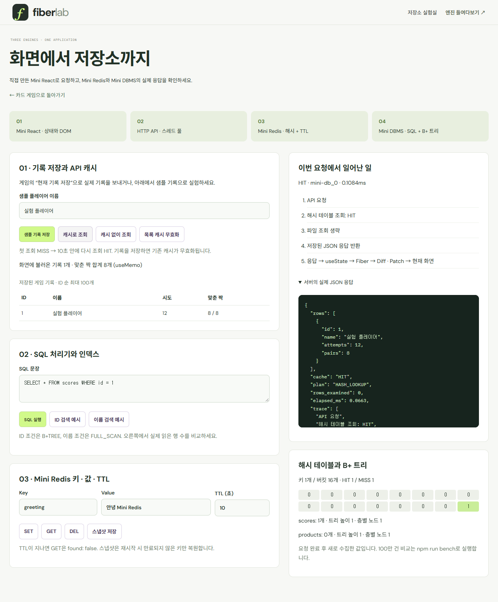
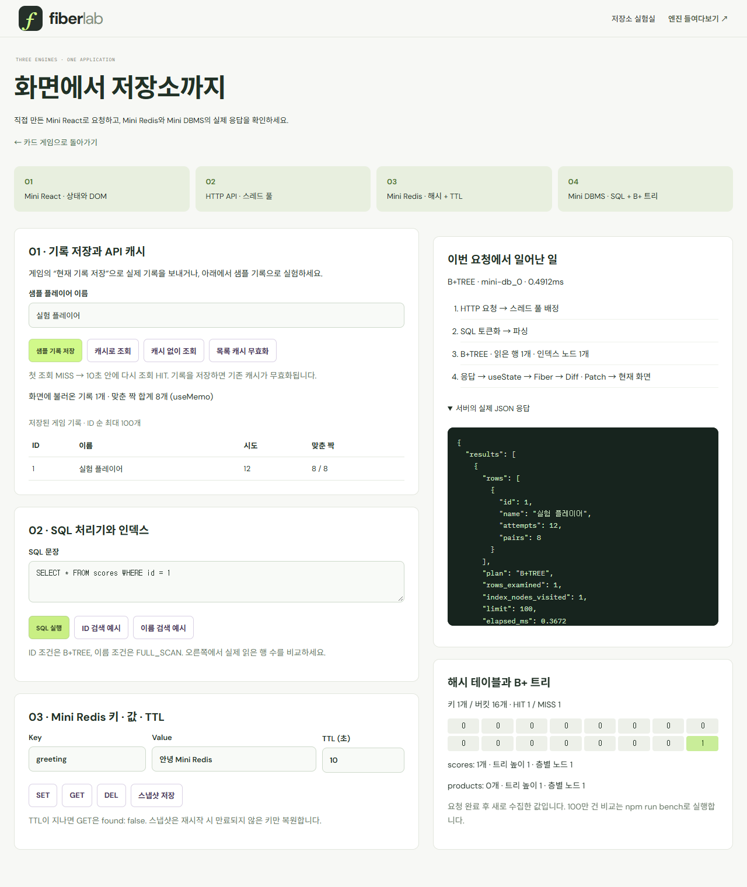

# Fiber Lab · Mini React × Mini Redis × Mini DBMS

**화면을 그리는 Mini React, 응답을 캐싱하는 Mini Redis, 파일과 인덱스로 데이터를 저장하는 Mini DBMS를 직접 구현한 프로젝트입니다.** 기존 카드 짝 맞추기와 Phase 1·Phase 2 렌더링 검사기를 유지하고, 게임 기록 저장과 저장소 실험실을 연결했습니다.

4×4 카드에서 한 장씩 두 장을 고르면 시도 횟수가 올라갑니다. 오른쪽 위 **렌더링 검사기**에서 그 클릭의 커밋을 열어 보세요. **Phase 2**는 상태 변경 요청 수와 상태·Props의 전후 값을, **Phase 1**은 같은 커밋에서 실제 DOM에 적용한 Patch를 보여줍니다.

[빠른 실행](#빠른-실행) · [Mini Redis](#mini-redis-해시-테이블과-api-캐시) · [Mini DBMS](#mini-dbms-sql--b-트리--스레드-풀) · [실측 성능](#100만-건과-캐시-성능-실측) · [Mini React Phase 2](#phase-2-상태와-hooks) · [Mini React Phase 1](#phase-1-virtual-dom과-dom-반영) · [Mini React 4분 발표](#4분-발표-순서)

[](docs/images/memory-game.png)

## 빠른 실행

개발과 CI 검증에는 Node.js 24를 사용합니다. Node.js 22를 사용한다면 22.12 이상이 필요합니다.

```bash
git clone https://github.com/kuk-hwan/mini-react-fiber-lab.git
cd mini-react-fiber-lab
npm ci
npm run dev
```

[http://127.0.0.1:5173](http://127.0.0.1:5173)에서 확인하세요. 브라우저는 `.ts` 파일을 직접 실행하지 않으므로 Vite가 개발 중에 JavaScript로 변환합니다. 배포할 때는 `dist/`의 컴파일된 정적 파일을 사용합니다.

```bash
npm run typecheck         # 소스·테스트·설정 strict 타입 검사
npm test                  # tsx + Node test runner + jsdom 단위·통합 테스트
npm run test:coverage     # 커버리지
npm run build             # 정적 결과물 dist/
npx playwright install chromium
npm run test:e2e          # 데스크톱 + 모바일 Chromium E2E
npm run preview           # 빌드 결과물 확인
```

기본 포트가 사용 중이면 `npm run dev -- --port 5174`로 바꾸세요. E2E는 별도 5186/8788 포트와 `.data/e2e-*` 폴더를 사용하므로 실행 중인 개발 서버의 데이터를 수정하지 않습니다. CI의 E2E는 Vite preview를 통해 `dist/` 결과물을 검증합니다.

### 서버까지 함께 실행하기

서버에는 **Python 3.12 이상**이 필요하며 별도 pip 설치는 없습니다. 위의 프런트엔드 터미널을 둔 채, 저장소 루트에서 새 터미널을 열어 실행하세요.

```bash
npm run server       # HTTP API: 127.0.0.1:8787
```

상단 **저장소 실험실** 또는 [/#systems](http://127.0.0.1:5173/#systems)로 이동합니다. 카드 게임의 **현재 기록 저장** 버튼은 실제 게임의 시도 횟수와 맞춘 짝 수를 파일 DB에 보냅니다. 서버를 실행하지 않아도 기존 카드 게임·렌더링 검사기는 사용할 수 있습니다.

```text
Mini React 화면
   ↓ fetch('/api/...')
HTTP API → 고정 스레드 풀
   ├─ 기록 저장: 파일 append → B+ 트리 등록 → 이전 캐시 무효화
   └─ 기록 조회: 해시 캐시 HIT → 저장된 JSON 반환
                  MISS → SQL → 파일 DB → TTL 캐시 저장
   ↓ JSON 응답
useState → Fiber → Virtual DOM → Diff → Patch → 화면 갱신
```

실행 데이터는 `.data/`에 저장하고 Git에서는 제외합니다. GitHub Pages 같은 정적 호스팅만으로 Python API 서버가 실행되지는 않습니다. 전체 설계·API·요구사항 대응·한계는 [서버 설계 문서](docs/SYSTEMS.md)를 참고하세요.

## Mini Redis: 해시 테이블과 API 캐시

[](docs/images/systems-cache.png)

**시연 순서:** 샘플 기록 저장 → 캐시로 조회(MISS) → 다시 캐시로 조회(HIT) → 캐시 없이 조회(BYPASS). HIT이면 파일을 읽지 않고 해시 테이블에 저장한 API 응답을 반환합니다. TTL은 10초이며 기록을 새로 저장하면 이전 목록 캐시를 삭제합니다.

- FNV-1a 해시, 배열 버킷, 체인으로 충돌 해결, 부하율 0.75 초과 시 2배 확장을 직접 구현했습니다.
- SET/GET/DEL, TTL 만료 시 삭제, 사용자 키와 API 응답 키 분리, 명령 단위 락을 제공합니다.
- 아래 KV 실험에서 TTL을 짧게 설정하고 GET을 누르면 `found: false`가 되는 것을 볼 수 있습니다.
- 선택 구현인 스냅샷은 임시 파일 → fsync → 교체로 저장합니다. 비정상 종료 시 마지막 스냅샷 이후의 캐시 변경은 유실될 수 있습니다.

[해시 테이블·TTL 코드](backend/cache.py) · [API와 캐시 무효화 코드](backend/server.py)

## Mini DBMS: SQL → B+ 트리 → 스레드 풀

[](docs/images/systems-sql.png)

| 과제 단계 | 구현한 기능                                                                           | 확인 방법                                            |
| --------- | ------------------------------------------------------------------------------------- | ---------------------------------------------------- |
| Phase 1   | SQL tokenizer/parser, INSERT/SELECT, 자동 ID, 테이블별 JSONL 파일                     | `npm run sql -- examples/demo.sql`                   |
| Phase 2   | 직접 만든 B+ 트리의 노드 분할·리프 연결, ID → 파일 바이트 위치, 재시작 시 인덱스 복원 | ID 검색과 이름 검색에서 `plan`, `rows_examined` 비교 |
| Phase 3   | 동일 엔진을 사용하는 HTTP API, 기본 8개 워커의 Thread Pool, 제한된 대기 큐            | 응답의 실제 `worker` 이름, 동시 HTTP 테스트          |

**시연 순서:** ID 검색 예시 → SQL 실행 → `B+TREE`와 읽은 행 수 확인 → 이름 검색 예시 → SQL 실행 → `FULL_SCAN` 비교. 오른쪽은 실제 서버 응답입니다. 100만 건 데이터는 화면용 폴더와 분리한 임시 폴더에서 측정합니다.

동시 INSERT의 **ID 발급·파일 쓰기·인덱스 갱신**은 테이블 락으로 보호합니다. 캐시를 채우는 도중 다른 요청이 데이터를 저장해 오래된 응답이 남는 문제도 별도 락으로 방지합니다. 같은 테이블 작업은 직렬화하며, 스레드 수만큼 CPU 처리 속도가 증가한다고 주장하지 않습니다.

[SQL 파서](backend/sql.py) · [파일 DB](backend/database.py) · [B+ 트리](backend/bptree.py) · [스레드 풀 API](backend/server.py)

## 100만 건과 캐시 성능 실측

2026-11-13, Windows 11 / Python 3.14.2에서 측정했습니다. 가짜 지연은 추가하지 않았습니다.

| 비교 항목                       | 측정 결과                                    |
| ------------------------------- | -------------------------------------------- |
| SQL 파싱 포함 100만 건 삽입     | 약 35.11초, 1만 건 단위 fsync                |
| ID 인덱스 검색 중앙값           | **0.314ms**, 트리 노드 4개 + 레코드 1개 읽음 |
| 이름 선형 검색 중앙값           | **3,198.444ms**, 레코드 100만 개 읽음        |
| 캐시 없이 실제 HTTP 조회 중앙값 | **2.078ms**                                  |
| 캐시 HIT 실제 HTTP 조회 중앙값  | **1.674ms** (이번 측정에서 약 1.24배)        |

인덱스 비교는 동일한 마지막 레코드를 5회씩 조회한 결과입니다. 캐시 비교는 1,000개 기록 중 첫 100개를 반환하는 같은 API를 30회씩 호출했습니다. 파일의 OS 캐시는 워밍업된 상태이며 캐시 값 복사·JSON 직렬화·HTTP 비용도 존재합니다. 데이터가 작으면 캐시가 더 느릴 수도 있습니다. 실제 Redis 제품과의 성능 비교가 아닙니다.

```bash
npm run test:backend  # Redis/DBMS 단위·동시성·실제 HTTP 기능 테스트
npm run bench         # 임시 폴더에서 100만 건 측정 후 JSON 보고서 생성
```

[원본 측정값과 환경](docs/benchmarks/latest.json) · [재현 코드](backend/benchmark.py) · [상세 설계와 지원 SQL 범위](docs/SYSTEMS.md)

아래는 기존 **Mini React 구현** 설명과 발표 대본입니다. Redis/DBMS의 Phase 번호와 별개의 과제 단계입니다.

## Phase 2 상태와 Hooks

캡처는 2번 카드를 먼저 뒤집고 같은 하트 K인 10번 카드를 고른 장면입니다. 카드 위치는 새 게임마다 달라질 수 있습니다. 오른쪽 위 **렌더링 검사기 열기 → Phase 2 · State**에서 `#3 · K 하트 짝 맞춤` 커밋의 상태와 자식 Props가 어떻게 바뀌었는지 볼 수 있습니다.

[](docs/images/memory-phase-2.png)

| 검사기 항목           | 변경 전 | 변경 후   |
| --------------------- | ------- | --------- |
| `open`                | `[2]`   | `[]`      |
| `matched`             | `[]`    | `[2, 10]` |
| `attempts`            | `0`     | `1`       |
| `Card[2].appearance`  | `open`  | `matched` |
| `Card[10].appearance` | `down`  | `matched` |

루트 `GameBoard`가 `useState`로 카드 상태와 시도 횟수를 관리합니다. 자식 `Card`는 `appearance` Prop을 받아 앞면, 뒷면, 짝 맞춤 상태의 Virtual DOM을 반환합니다.

### 카드 게임에서 배칭 확인하기

1. **첫 번째 카드**를 누르면 `setGame()`으로 그 카드의 앞면을 보여줍니다. 시도 횟수는 그대로입니다.
2. **두 번째 카드**를 누르면 같은 클릭에서 `setGame()`으로 짝 판정 결과를, `setAttempts()`로 시도 횟수 증가를 요청합니다.
3. 엔진이 두 요청을 모아 카드 모습과 시도 횟수를 한 번에 반영합니다. 이 배칭 결과가 검사기의 **상태 변경 요청 2개 · 커밋 1회**입니다.

`useMemo`는 카드의 클릭 함수를 재사용합니다. 시도 횟수는 짝 맞춤 성공 여부와 관계없이 올라갑니다. 서로 다른 카드를 고르면 DOM 반영 뒤 `useEffect`가 1.2초 타이머를 예약합니다. 타이머가 두 카드를 다시 덮는 과정은 커밋 목록에서 따로 볼 수 있습니다. 새 게임을 시작하면 시도 횟수는 0이 됩니다. [게임 코드](src/demo/memory-game.ts)

## Phase 1 Virtual DOM과 DOM 반영

검사기를 **Phase 1 · DOM**으로 바꾸면 **같은 하트 K 짝 맞춤 커밋**의 실제 Patch 기록을 확인할 수 있습니다.

[](docs/images/memory-phase-1.png)

- **`PROPS`**는 두 카드의 `className`을 `memory-card-matched`가 포함된 값으로 바꾸고, 완료 표식과 접근성 라벨을 갱신합니다.
- **`TEXT`**는 카드 안내 문구, 하단의 시도 횟수와 맞춘 짝 수처럼 바뀐 텍스트를 반영합니다.
- **경로**는 변경된 노드가 Virtual DOM 트리의 어디에 있는지 나타냅니다. 카드 자리마다 같은 `key`를 사용하므로 뒤집은 뒤에도 기존 카드 버튼 DOM을 재사용합니다.

검사기는 커밋에서 수집한 실제 Patch 작업과 Virtual DOM의 전후 값을 표시합니다. 목록 상단의 숫자는 **선택한 커밋의 논리적 Patch 작업 수**입니다. [Diff 코드](src/core/diff.ts) · [Patch 코드](src/core/patch.ts) · [검사기 코드](src/demo/game-inspector.ts)

## 4분 발표 순서

발표에서는 README 맨 위에서 출발해 **Phase 2 → Phase 1 → 구현의 중심** 순서로 내려가면 됩니다. 두 캡처는 같은 커밋이라 화면을 띄운 채 상태 변화와 DOM 반영을 연결해서 설명할 수 있습니다.

| 시간      | README에서 보여줄 곳                                              | 설명할 내용                                                                                             |
| --------- | ----------------------------------------------------------------- | ------------------------------------------------------------------------------------------------------- |
| 0:00–0:25 | 맨 위 게임 사진                                                   | 카드 한 번의 선택이 어떻게 화면 변경으로 이어지는지 보여주는 Mini React입니다.                          |
| 0:25–1:25 | [Phase 2 상태와 Hooks](#phase-2-상태와-hooks)                     | `matched`, `attempts`의 전후 값을 짚고 요청 2개가 한 커밋에 처리된 기록을 보여줍니다.                   |
| 1:25–2:30 | [Phase 1 Virtual DOM과 DOM 반영](#phase-1-virtual-dom과-dom-반영) | 같은 커밋에서 카드가 금색으로 바뀌고 하단에 `시도 1회`, `맞춘 짝 1 / 8`이 표시됩니다.                   |
| 2:30–3:30 | [구현의 중심](#구현의-중심)                                       | 상태 변경 요청부터 Fiber의 컴포넌트 실행, Virtual DOM 생성, Diff·Patch까지 흐름도를 따라갑니다.         |
| 3:30–4:00 | [검증과 차별점](#검증과-차별점)                                   | 카드 버튼이 같은 DOM 객체로 유지되는지와, 다른 카드 두 장이 타이머로 다시 덮이는 동작을 테스트했습니다. |

### 4분 발표 대본

<details>
<summary>발표 대본과 화면에서 가리킬 곳 펼치기</summary>

#### 0:00–0:25 · 게임 소개

**화면**　README 맨 위의 전체 사진에서 하트 K 두 장을 차례로 가리킵니다.

안녕하세요. 제가 만든 프로젝트는 TypeScript로 직접 구현한 Mini React입니다. 화면을 어떻게 업데이트하는지 보여주려고 4×4 카드 짝 맞추기 게임에 연결했습니다. 사진에서 2번과 10번 카드가 같은 하트 K인데요. 두 번째 카드를 눌렀을 때 게임이 어떤 값을 바꾸고, 그 결과가 화면에 어떻게 나타나는지 순서대로 보여드리겠습니다.

#### 0:25–1:25 · Phase 2에서 배칭 설명

**화면**　사진 오른쪽에서 `open` → `matched` → `attempts`를 한 줄씩 가리킵니다. 마지막에 위쪽의 **`상태 변경 요청 2개 · 커밋 1회`**를 짚습니다. [Phase 2 사진으로 이동](#phase-2-상태와-hooks)

먼저 2번 카드를 누르면 그 카드의 앞면이 보입니다. 오른쪽 `open`에 있는 `[2]`는 이때 잠깐 열어 둔 카드 번호예요. 그다음 10번 카드를 누르면 게임이 두 장을 비교합니다. 같은 하트 K니까 이제 잠깐 열어 둔 목록은 비우고, 아래 `matched`, 즉 짝을 맞춘 목록에 2번과 10번을 넣습니다.

그리고 두 장을 비교했으니 시도 횟수도 하나 올립니다. 여기 `attempts`가 0에서 1로 바뀌죠. 시도 횟수는 짝이 맞아도, 틀려도 두 장을 비교할 때 한 번 올라갑니다.

여기서 위쪽을 보시면 **요청 2개, 커밋 1회**라고 적혀 있어요. 두 번째 클릭에서 **짝 판정 결과를 반영해 달라는 요청**과 **시도 횟수를 올려 달라는 요청**이 각각 들어왔습니다. 엔진이 이 두 가지를 모아서 카드 모습과 시도 횟수를 한 번에 화면에 보여줍니다. 이게 배칭입니다.

#### 1:25–2:30 · Phase 1에서 바뀐 부분 확인

**화면**　사진 오른쪽 위 `#3 · K 하트 짝 맞춤`을 짚고, `className` 변경 → 왼쪽 금색 카드 → 하단 `시도 1회` 순으로 가리킵니다. [Phase 1 사진으로 이동](#phase-1-virtual-dom과-dom-반영)

이 사진도 위에 보이는 번호가 `#3`입니다. 방금 Phase 2에서 본 것과 같은 커밋이에요. 이번에는 바뀐 게임 상태가 실제 화면에 어떻게 적용됐는지 볼 수 있습니다.

엔진은 먼저 새 화면이 어떤 모습이어야 하는지 객체로 적어 둡니다. 이게 **Virtual DOM**, 쉽게 말하면 화면 설계도입니다. **Diff**는 클릭하기 전의 설계도와 클릭한 뒤의 설계도를 비교해서 변경 목록을 만듭니다.

예를 들어 오른쪽 `className` 줄을 보면, 먼저 열었던 카드에 짝 맞춤을 뜻하는 `memory-card-matched` 클래스가 생깁니다. **Patch**가 이 클래스를 실제 카드 버튼에 붙이면 브라우저가 금색 테두리를 그립니다. 체크 표시도 보이게 바뀌고, 아래의 시도 횟수와 맞춘 짝 수가 각각 올라갑니다.

여기서 카드 버튼은 기존 것을 계속 사용합니다. 이미 있는 버튼의 속성과 안쪽 표시를 고친 거예요. 이처럼 **커밋 한 번 안에서 카드와 숫자 등 여러 부분이 함께 바뀔 수 있습니다.**

#### 2:30–3:30 · 엔진이 두 요청을 모으는 과정

**화면**　흐름도에서 `setState queue`에 먼저 마우스를 멈춥니다. 그다음 `Fiber` → `diffSteps()` → `patch()`를 차례로 가리킵니다. [구현의 중심으로 이동](#구현의-중심)

그럼 엔진은 두 요청을 언제 모을까요? 두 번째 카드를 눌렀을 때 `setGame()`이 카드 상태 변경을 대기열에 넣고, 다음 렌더링을 예약합니다. 같은 클릭에서 바로 이어서 `setAttempts()`도 대기열에 요청을 넣어요. 이미 렌더링이 예약되어 있으니, 두 요청은 그 차례를 함께 씁니다.

예약한 차례가 오면 **Fiber**가 게임판 컴포넌트를 다시 실행합니다. Fiber는 카드처럼 화면을 이루는 요소들을 작업 단위로 따라갑니다. 게임판은 `useState`를 통해 새 카드 상태와 시도 횟수를 받고, 자식 카드에게는 **Props**, 즉 화면을 그리는 데 필요한 값을 넘깁니다. 예를 들어 10번 카드는 `matched`라는 값을 받아 완료된 카드의 모습을 만들어요.

이렇게 새 Virtual DOM을 완성하면 Diff가 변경 목록을 만들고, 마지막에 Patch가 그 목록을 실제 DOM에 적용합니다. 그래서 검사기에는 두 요청을 적용한 결과가 **커밋 한 건**으로 남습니다.

#### 3:30–4:00 · 실패한 경우와 검증

**화면**　카드 게임 테스트 항목을 가리킵니다. [검증과 차별점으로 이동](#검증과-차별점)

짝이 틀렸을 때도 시도 횟수는 한 번 올라갑니다. 두 장의 앞면이 화면에 반영된 뒤 `useEffect`가 타이머를 걸고, 약 1.2초 뒤 두 카드가 다시 덮입니다. 이때는 시간이 지난 뒤 새 요청이 생기기 때문에 검사기에 커밋이 따로 남습니다.

데스크톱과 모바일에서 이 동작과 배칭 기록을 확인했습니다. 이 게임에서는 카드 한 장을 누른 뒤 어떤 상태가 바뀌고, 실제 화면의 어느 부분이 갱신됐는지 한 커밋에서 따라갈 수 있습니다. 감사합니다.

</details>

## 구현의 중심

```text
사용자 이벤트 → setState queue
                    ↓
       FunctionComponent.update()
                    ↓
   Work-in-progress Fiber (child / sibling / return)
         함수 평가 + host Virtual DOM 생성
                    ↓
          공유 diffSteps() → 변경 계획
                    ↓
   동기 commit: patch() → hooks 확정 → effects
```

Fiber는 `child`, `sibling`, `return`으로 작업 위치를 기록합니다. 한 차례의 작업에 약 5ms를 할당하고, 남은 작업은 다음 차례에 이어갈 수 있습니다. 렌더링에서 새 Virtual DOM과 변경 계획을 완성한 뒤 커밋에서 `patch()`로 실제 DOM에 적용합니다.

카드 게임과 작업 보드는 `FunctionComponent`로 렌더링을 예약합니다. Fiber 엔진이 함수형 컴포넌트를 실행해 Virtual DOM을 만들고 `diffSteps()`와 `patch()`를 호출합니다. HTML 실험실은 편집된 DOM을 Virtual DOM으로 바꾼 뒤 `diff()`로 같은 비교 엔진을 실행하고 `patch()`로 반영합니다. 엔진과 데모는 strict TypeScript로 작성했고 UI 프레임워크나 런타임 npm 의존성 없이 동작합니다.

<details>
<summary>엔진 사용 예제 · Counter 컴포넌트</summary>

```ts
import { h, FunctionComponent, useState, useEffect, useMemo } from './src/core/index.ts';

function Label({ value }: { value: number }) {
  return h('strong', {}, value);
} // 자식 Hook 금지

function Counter() {
  const [count, setCount] = useState(0);
  const doubled = useMemo(() => count * 2, [count]);
  useEffect(() => {
    const previous = document.title;
    document.title = `count: ${count}`;
    return () => {
      document.title = previous;
    };
  }, [count]);
  return h('button', { onClick: () => setCount((n) => n + 1) }, h(Label, { value: doubled }));
}

const root = document.querySelector('#root');
if (!root) throw new Error('root 요소가 필요합니다.');
const app = new FunctionComponent(Counter).mount(root);
await app.whenIdle();
// app.update({ ...newProps });
// app.unmount();
```

</details>

## 추가 실험

| 화면                                            | 확인할 수 있는 것                                                                          |
| ----------------------------------------------- | ------------------------------------------------------------------------------------------ |
| [HTML 실험실](http://127.0.0.1:5173/#lab)       | DOM → VNode 변환, HTML 편집과 Patch, 이전·다음 스냅샷 복원                                 |
| [Hooks 작업 보드](http://127.0.0.1:5173/#hooks) | 작업 추가 실행 기록, `useMemo`·`useEffect`, `+3`의 요청 3개를 커밋 한 번으로 처리하는 배칭 |

작업 보드에서 **`+3 한 번에`**를 누르면 `setBatchCount(n => n + 1)`이 세 번 호출됩니다. 엔진은 이미 예약한 렌더링에서 세 요청을 순서대로 계산하고, 최종값을 한 번 커밋합니다. 배칭 카드에 **상태 변경 요청 3개 · 커밋 1회**가 표시됩니다. [작업 보드 코드](src/demo/board.ts) · [배칭 테스트](tests/hooks.test.ts)

## 소스 안내

| 경로                                                       | 역할                                            |
| ---------------------------------------------------------- | ----------------------------------------------- |
| `src/core/vnode.ts`                                        | h, DOM → VNode, key 매칭                        |
| `src/core/dom.ts`                                          | DOM 생성, 속성·이벤트·폼·SVG 반영               |
| `src/core/diff.ts`                                         | 5가지 핵심 변경 계획, 중복 key 검증, generator  |
| `src/core/patch.ts`                                        | 계획을 실제 DOM에 적용, key 이동·정체성 보존    |
| `src/core/fiber.ts`                                        | FunctionComponent, 작업 루프, commit, lifecycle |
| `src/core/hooks.ts`                                        | 호출 순서 기반 슬롯, 상태 큐, effect, memo      |
| `src/lab/`                                                 | Phase 1 편집기, HTML 제한, 이력                 |
| [`src/demo/memory-game.ts`](src/demo/memory-game.ts)       | 카드 상태, 순수 Card 컴포넌트, 다시 덮는 타이머 |
| [`src/demo/game-inspector.ts`](src/demo/game-inspector.ts) | 커밋 이력, 상태·Props 전후, 실제 Patch 기록     |
| [`src/demo/memory-table.css`](src/demo/memory-table.css)   | 화면 전체를 채우는 테이블과 오른쪽 검사기 배치  |
| `src/demo/board.ts`                                        | Phase 2 루트와 순수 자식 컴포넌트               |
| `tests/`                                                   | 단위·통합·회귀 테스트 및 E2E                    |
| `docs/ARCHITECTURE.md`                                     | 핵심 코드 설명, 설계 판단, 학습 질문            |
| `docs/REQUIREMENTS.md`                                     | 과제 요구사항과 코드·검증 연결                  |

공통 타입은 `src/core/types.ts`, DOM 유틸리티는 `src/shared/dom.ts`에 있습니다. `tsconfig.json`은 strict 타입 검사, `vite.config.ts`는 개발 서버와 정적 빌드를 설정합니다. 구성과 타입 설계는 [TypeScript 가이드](docs/TYPESCRIPT.md)를 참고하세요.

## 검증과 차별점

- **41개 단위·통합·회귀 테스트**: 실제 DOM 객체의 동일성까지 검증
- **23개 서버 테스트**: 해시 충돌·TTL·스냅샷, B+ 트리 불변식, 파일 복원·손상 감지, 동시 요청·과부하와 캐시 무효화 검증
- **컴파일 전용 타입 계약**: 잘못된 상태 값·updater 반환형·자식 props·effect 반환값·Patch 계획을 타입 검사에서 거부
- 120개의 결정적 무작위 key 배열 변경을 새 렌더링 결과와 대조
- 초기화·이벤트 교체·폼 값·SVG·주석·공백·빈 트리·중복 key 검사
- Hook 순서 위반, render 중 DOM 불변, render 도중 들어온 상태 변경, unmount와 이전 setter 검사
- E2E 7개 시나리오를 데스크톱과 모바일 프로필로 각각 실행(총 14개). 로컬 Edge 검증을 완료했으며 CI는 Chromium을 사용합니다.
- 카드 뒤집기와 짝 맞춤, 시도 횟수와 배칭 기록, `useEffect` 타이머, 검사기 탭과 실제 Patch 기록을 브라우저에서 확인

`PATCH OPS`는 이벤트 리스너 교체를 포함한 논리적 Patch 작업 수입니다. 하나의 subtree CREATE도 한 작업으로 셉니다. 실제 브라우저 layout/paint 횟수나 생성한 전체 DOM 노드 수와 같지 않습니다. 시간 수치는 로컬 측정이며 React와의 성능 비교 결과가 아닙니다.

## 범위와 한계

교육용 Fiber 구현이며 React와 API/동작이 완전히 호환되지는 않습니다.

- Hook과 상태는 **루트에서만** 사용합니다. 컴포넌트는 하나의 VNode나 문자열·숫자를 반환할 수 있습니다. `null`, `undefined`, 불리언은 빈 출력으로 처리합니다. Fragment·Portal은 미지원입니다.
- Hook 호출 순서가 일정해야 합니다. 조건부 Hook의 종류·개수 변경은 오류로 처리합니다.
- Render는 협력적으로 양보하지만 단일 함수 호출, 넓은 형제 목록의 매칭, 동기 commit은 도중에 중단하지 않습니다.
- 효과는 커밋 중 `patch()`로 DOM을 수정한 뒤 동기 실행합니다. React의 passive effect/paint 타이밍이나 Strict Mode 재실행을 재현하지 않습니다.
- lanes, priority, Suspense, SSR/hydration, Error Boundary, Context, class component는 구현하지 않았습니다.
- key는 형제 사이에서 유일해야 합니다. unkeyed 항목은 위치로 매칭합니다. 이동은 정확한 결과와 DOM 재사용을 목표로 하며 전역 최소 이동 횟수는 보장하지 않습니다.
- HTML 실험실은 허용된 태그·속성만 다룹니다. script/iframe/inline handler/file input 등은 제외합니다. 일반 목적의 검증된 HTML sanitizer를 대체하는 라이브러리가 아닙니다.
- DOM 변경은 브라우저 기본 API로 처리합니다. 모든 DOM API, custom element, MathML, 임의 네임스페이스 속성을 지원하지 않습니다.
- Google Fonts는 선택적 시각 리소스입니다. 네트워크가 없으면 시스템 폰트로 실행됩니다.

참고한 원문과 실제 React와의 비교는 [설계 문서](docs/ARCHITECTURE.md)에 정리했습니다.
