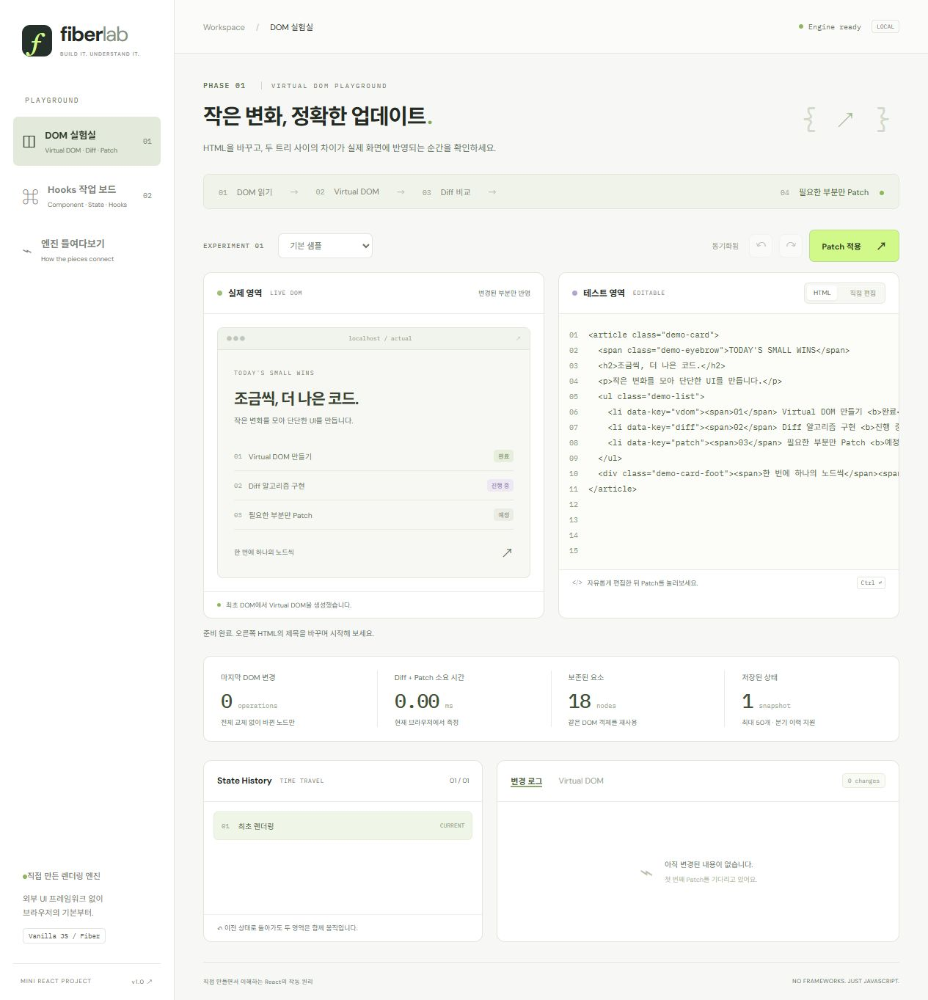
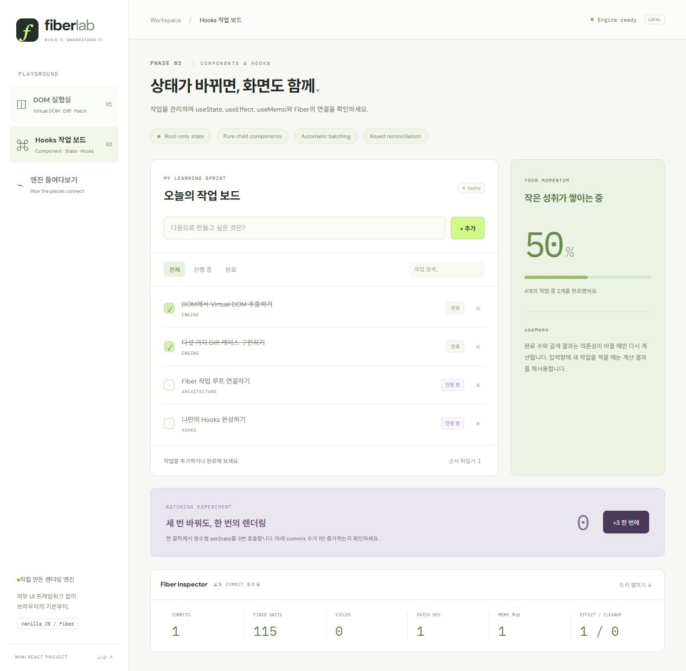

# Fiber Lab · Mini React

**Virtual DOM → Diff → Patch → Fiber → Hooks를 직접 구현한 Vanilla JavaScript 프로젝트입니다.**

두 Phase가 같은 렌더링 엔진을 사용합니다. React, Vue, UI 라이브러리, 번들러 없이 브라우저 ES Modules로 실행합니다. 테스트 도구만 개발 의존성으로 사용합니다.



## 빠른 실행

Node.js 22 이상이 필요합니다. 개발·검증 환경은 Node.js 24입니다.

```bash
git clone https://github.com/kuk-hwan/mini-react-fiber-lab.git
cd mini-react-fiber-lab
npm ci
npm run dev
```

[http://127.0.0.1:5173](http://127.0.0.1:5173)에서 확인하세요. HTML 파일을 직접 여는 `file://` 방식은 ES Module 보안 제약 때문에 지원하지 않습니다. 앱 실행 자체에는 npm 패키지가 필요하지 않아 `node scripts/serve.js`만으로도 실행할 수 있습니다.

```bash
npm test                  # Node test runner + jsdom 단위·통합 테스트
npm run test:coverage     # 커버리지
npm run build             # 정적 결과물 dist/
npx playwright install chromium
npm run test:e2e          # 데스크톱 + 모바일 Chromium E2E
node scripts/serve.js --dist  # 빌드 결과물 확인
```

기본 포트가 사용 중이면 `PORT` 환경 변수를 바꾸세요. PowerShell 예: `$env:PORT=5174; npm run dev`.

## 직접 해볼 수 있는 것

### Phase 1 — DOM 실험실

1. 실제 영역의 샘플 DOM을 읽어 Virtual DOM을 만듭니다.
2. 해당 트리를 이용해 테스트 영역을 렌더링합니다.
3. HTML 소스를 수정하거나 **직접 편집**에서 문구·폼 값을 수정합니다.
4. **Patch 적용** 또는 **Ctrl/Cmd + Enter**로 변경 부분만 실제 DOM에 반영합니다.
5. **뒤로가기 / 앞으로가기 / 이력 항목**으로 두 영역을 함께 복원합니다.

텍스트·속성·추가·삭제·교체·key 재정렬·폼·SVG 예제가 있습니다. `MutationObserver`는 직접 편집의 구조·속성·텍스트 변경을 관찰하며, DOM 속성 변경 알림이 발생하지 않는 폼 값은 input 이벤트와 DOM 스냅샷으로 읽습니다.

이력은 깊은 복사로 최대 50개를 보관합니다. 변경이 없으면 이력을 추가하지 않고, 과거에서 새 Patch를 만들면 앞으로가기 분기를 제거합니다. 이력 이동은 적용하지 않은 편집 내용을 선택한 스냅샷으로 교체합니다.

### Phase 2 — Hooks 작업 보드



- 작업 추가·완료·삭제·검색·필터·순서 반전
- 루트 `Board`가 모든 상태를 관리하고 `TaskRow`, `ProgressCard`는 props만 받는 순수 함수
- `useMemo`: 작업 목록/검색/필터 의존성이 바뀔 때만 필터링·완료 수 계산
- `useEffect`: localStorage 저장과 문서 제목 갱신, 이전 effect cleanup
- **+3 한 번에**: 함수형 상태 갱신 세 번을 하나의 commit으로 묶는 실험
- 실제 Fiber 트리, commit 수, 처리한 Fiber 수, yield 수, memo/effect 실행 수 확인

작업은 이 브라우저의 localStorage에 저장되며 서버로 전송하지 않습니다. 저장소 접근이 불가능해도 메모리에서 동작합니다.

## 구현의 중심

```text
사용자 이벤트 → setState queue
                    ↓
       FunctionComponent.update()
                    ↓
   Work-in-progress Fiber (child / sibling / return)
         함수 평가 + host Virtual DOM 생성
                    ↓
          공유 diffSteps() → 변경 계획
                    ↓
   동기 commit: patch() → hooks 확정 → effects
```

Fiber는 개별 작업 사이에 양보할 수 있는 트리입니다. **5ms 예산을 가진 macrotask**가 작업을 이어갑니다. `current`는 commit된 트리, 작업 중 트리는 다음 버전, `alternate`는 이전 Fiber를 참조합니다. 전체 render가 완료되기 전에는 실제 DOM을 수정하지 않습니다.

Phase 1은 HTML 스냅샷끼리 `diff()`를 직접 실행합니다. Phase 2는 함수형 컴포넌트를 Fiber 작업으로 평가한 뒤 같은 `diffSteps()` / `patch()`로 host DOM을 갱신합니다. Phase 2만을 위한 별도 DOM 교체 구현은 없습니다.

```js
import { h, FunctionComponent, useState, useEffect, useMemo } from './src/core/index.js';

function Label({ value }) {
  return h('strong', {}, value);
} // 자식 Hook 금지

function Counter() {
  const [count, setCount] = useState(0);
  const doubled = useMemo(() => count * 2, [count]);
  useEffect(() => {
    const previous = document.title;
    document.title = `count: ${count}`;
    return () => {
      document.title = previous;
    };
  }, [count]);
  return h('button', { onClick: () => setCount((n) => n + 1) }, h(Label, { value: doubled }));
}

const app = new FunctionComponent(Counter).mount(document.querySelector('#root'));
await app.whenIdle();
// app.update({ ...newProps });
// app.unmount();
```

## 소스 안내

| 경로                   | 역할                                            |
| ---------------------- | ----------------------------------------------- |
| `src/core/vnode.js`    | h, DOM → VNode, key 매칭                        |
| `src/core/dom.js`      | DOM 생성, 속성·이벤트·폼·SVG 반영               |
| `src/core/diff.js`     | 5가지 핵심 변경 계획, 중복 key 검증, generator  |
| `src/core/patch.js`    | 계획을 실제 DOM에 적용, key 이동·정체성 보존    |
| `src/core/fiber.js`    | FunctionComponent, 작업 루프, commit, lifecycle |
| `src/core/hooks.js`    | 호출 순서 기반 슬롯, 상태 큐, effect, memo      |
| `src/lab/`             | Phase 1 편집기, HTML 제한, 이력                 |
| `src/demo/board.js`    | Phase 2 루트와 순수 자식 컴포넌트               |
| `tests/`               | 단위·통합·회귀 테스트 및 E2E                    |
| `docs/ARCHITECTURE.md` | 핵심 코드 설명, 설계 판단, 학습 질문            |
| `docs/REQUIREMENTS.md` | 과제 요구사항과 코드·검증 연결                  |

## 검증과 차별점

- **41개 단위·통합·회귀 테스트**: 실제 DOM 객체의 동일성까지 검증
- 120개의 결정적 무작위 key 배열 변경을 새 렌더링 결과와 대조
- 초기화·이벤트 교체·폼 값·SVG·주석·공백·빈 트리·중복 key 검사
- Hook 순서 위반, render 중 DOM 불변, render 도중 들어온 상태 변경, unmount와 이전 setter 검사
- E2E 3개 시나리오를 데스크톱/모바일 두 환경에서 실행하는 GitHub Actions CI
- 실제 측정값을 사용하는 변경 로그·시간 이동·Fiber Inspector

`PATCH OPS`는 이벤트 리스너 교체를 포함한 논리적 Patch 작업 수입니다. 하나의 subtree CREATE도 한 작업으로 셉니다. 실제 브라우저 layout/paint 횟수나 생성한 전체 DOM 노드 수와 같지 않습니다. 시간 수치는 로컬 측정이며 React와의 성능 비교 결과가 아닙니다.

## 범위와 한계

교육용 Fiber 구현이며 React와 API/동작이 완전히 호환되지는 않습니다.

- Hook과 상태는 **루트에서만** 사용합니다. 컴포넌트는 하나의 VNode, 문자열/숫자 또는 null을 반환합니다. Fragment·Portal은 미지원입니다.
- Hook 호출 순서가 일정해야 합니다. 조건부 Hook의 종류·개수 변경은 오류로 처리합니다.
- Render는 협력적으로 양보하지만 단일 함수 호출, 넓은 형제 목록의 매칭, 동기 commit은 도중에 중단하지 않습니다.
- 효과는 commit 후 동기 실행합니다. React의 passive effect/paint 타이밍이나 Strict Mode 재실행을 재현하지 않습니다.
- lanes, priority, Suspense, SSR/hydration, Error Boundary, Context, class component는 구현하지 않았습니다.
- key는 형제 사이에서 유일해야 합니다. unkeyed 항목은 위치로 매칭합니다. 이동은 정확한 결과와 DOM 재사용을 목표로 하며 전역 최소 이동 횟수는 보장하지 않습니다.
- HTML 실험실은 허용된 태그·속성만 다룹니다. script/iframe/inline handler/file input 등은 제외합니다. 일반 목적의 검증된 HTML sanitizer를 대체하는 라이브러리가 아닙니다.
- DOM 변경은 브라우저 기본 API로 처리합니다. 모든 DOM API, custom element, MathML, 임의 네임스페이스 속성을 지원하지 않습니다.
- Google Fonts는 선택적 시각 리소스입니다. 네트워크가 없으면 시스템 폰트로 실행됩니다.

참고한 원문과 실제 React와의 비교는 [설계 문서](docs/ARCHITECTURE.md)에 정리했습니다.
