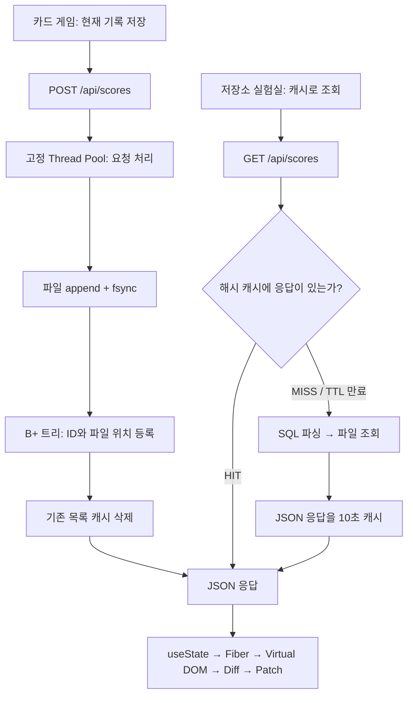

# Mini React → Mini Redis → Mini DBMS

기존 화면 엔진을 유지하면서 서버까지 직접 구현한 학습 프로젝트입니다. 프런트엔드는 strict TypeScript, 서버는 Python 3.12 이상과 표준 라이브러리만 사용합니다. Redis/SQLite 같은 완성된 저장 엔진은 사용하지 않습니다.

## 한 번의 요청을 따라가기



카드 뒤집기에는 서버가 필요하지 않습니다. **현재 기록 저장**을 누르면 그 순간 커밋된 `attempts`, `matched.length / 2`를 전송합니다. 새 게임으로 초기화해도 저장한 파일은 유지됩니다. 지금 구현한 기록 목록은 ID 순 첫 100개이며 랭킹 정렬/페이지네이션은 아닙니다. 샘플 저장은 이름·시도 12·맞춘 짝 8을 사용한다고 화면에 구분했습니다.

저장소 실험실 역시 `FunctionComponent`로 마운트합니다. 루트에서 `useState`로 응답과 입력을 관리하고, `ScoreTable`은 Props만 사용합니다. `useMemo`는 불러온 행의 합계를 계산하고, `useEffect`는 최초 연결 상태를 조회합니다. 오른쪽 서버 경로는 실제 요청 결과의 `cache`, `plan`, `rows_examined`, `worker`를 표시합니다. 이는 CPU 내부를 중단해서 한 명령씩 실행하는 디버거는 아닙니다.

## 시작하기

저장소 루트에서 두 터미널을 사용합니다.

```bash
# 터미널 1: API, Redis, DB 엔진
npm run server

# 터미널 2: Mini React UI
npm run dev
```

`http://127.0.0.1:5173/#systems`에서 확인합니다. Vite가 `/api` 요청을 `127.0.0.1:8787`로 전달합니다. 서버가 꺼져 있으면 오류 안내를 보여주며, 서버 시작 후 버튼을 다시 누르면 연결됩니다.

CLI는 파일 안의 SQL을 순서대로 처리합니다. 기본 경로 `.data/cli`는 서버의 `.data/server`와 별개입니다.

```bash
npm run sql -- examples/demo.sql
python -m backend.cli examples/demo.sql --data .data/other
python -m backend.server --port 8787 --workers 8 --data .data/server
```

하나의 데이터 폴더는 한 프로세스만 소유할 수 있습니다. 이미 API 서버가 사용 중인 폴더를 CLI에서 열면 명확한 오류가 발생합니다. HTTP API에는 네트워크 클라이언트가 접근할 수 있습니다. 기본은 로컬 바인딩이며 `--host 0.0.0.0`은 실습용 사설 네트워크에서만 사용하세요. 인증/TLS/권한 제어를 제공하지 않으므로 인터넷 공개 서비스용은 아닙니다. GitHub에 파일을 올리는 것만으로 Python 서버가 호스팅되지는 않습니다.

## Mini Redis의 내부

| 구성         | 구현과 이유                                                       | 코드                         |
| ------------ | ----------------------------------------------------------------- | ---------------------------- |
| 해시 함수    | UTF-8 바이트에 FNV-1a 적용 → 배열 인덱스 계산                     | `HashTable.slot()`           |
| 충돌 처리    | 같은 칸의 `(key, value)` 목록에서 키를 비교하는 separate chaining | `HashTable.get/set/delete()` |
| 확장         | 항목 수 / 버킷 수가 0.75 초과하면 2배 확장 후 다시 해싱           | `HashTable.set()`            |
| 평균/최악    | 평균 조회 O(1), 충돌이 심하면 O(n). 확장 시 O(n)                  | `backend/cache.py`           |
| TTL          | 절대 만료 시각 저장. GET 시 만료되면 삭제 후 `found: false`       | `MiniRedis.get()`            |
| 메모리 정리  | metrics와 snapshot에서 sweep. 상시 백그라운드 만료 스레드는 없음  | `MiniRedis.sweep()`          |
| 무효화       | 명시적 DEL, TTL, 저장 후 목록 캐시 삭제                           | `Application.dispatch()`     |
| 동시성       | 명령 전체를 RLock으로 보호. 반환 객체 복제로 외부 변경 방지       | `MiniRedis`                  |
| 내구성(선택) | 임시 파일에 snapshot → flush/fsync → atomic replace               | `snapshot()/restore()`       |

핵심 키 저장은 직접 만든 배열+체인입니다. Python `dict`는 JSON 레코드/스키마 표현에만 사용합니다. 저장한 JSON `null`과 키가 없는 경우는 `found`로 구별합니다. TTL=0은 즉시 만료, 음수·NaN·무한대는 거부합니다. 사용자 KV는 `user:`, API 응답은 `response:`로 내부 이름 공간을 나누므로 사용자가 같은 이름으로 응답 캐시를 덮어쓰지 않습니다.

스냅샷은 **마지막 저장 시점 이후 변경을 보장하지 않습니다**. 수동 저장 또는 정상 종료 때 저장하며 AOF는 구현하지 않았습니다. 비정상 종료에서 마지막 스냅샷 이후 캐시 데이터는 잃을 수 있습니다. 재시작 시 이미 만료된 키는 제외하고, API 응답 캐시는 새로 채웁니다. 메모리 상한/LRU eviction/Redis RESP 프로토콜/분산 복제는 제공하지 않습니다.

## DBMS Phase 1: SQL → 파일

`backend/sql.py`는 정규식 tokenizer로 문자열·정수·식별자·기호를 구분한 다음 parser로 명령 구조를 만듭니다. SQL 문자열을 `eval`하거나 쉘로 실행하지 않습니다. 작은따옴표 안의 세미콜론, `''` 이스케이프, `--` 주석을 처리합니다.

스키마는 이미 존재한다는 과제 조건에 따라 코드로 고정합니다.

| 테이블   | 자동 필드     | 입력 필드                                     |
| -------- | ------------- | --------------------------------------------- |
| scores   | id: 증가 정수 | name: 문자열, attempts: 정수, pairs: 0~8 정수 |
| products | id: 증가 정수 | name: 문자열, price: 정수                     |

```sql
INSERT INTO scores (name, attempts, pairs) VALUES ('국환', 12, 8);
SELECT * FROM scores WHERE id = 1;
SELECT name, attempts FROM scores WHERE name = '국환' LIMIT 20;
```

- 최소 지원 범위: INSERT 단일 행, SELECT `*` 또는 명시한 열, 선택적 WHERE 동등 비교 한 개, LIMIT 1~1000(기본 100).
- 지원하지 않는 문법: CREATE/UPDATE/DELETE/JOIN/ORDER BY/AND/OR/트랜잭션. 알 수 없는 문법·테이블·열·잘못된 타입은 거부합니다.
- `scores.jsonl`, `products.jsonl`에 UTF-8 JSON 한 행씩 추가합니다. ID는 외부에서 지정할 수 없습니다.
- 성공 응답 전에 파일 flush/fsync를 호출하고 인덱스를 갱신합니다. CLI 여러 문장은 순서대로 실행하지만 전체가 하나의 트랜잭션은 아닙니다. 앞 문장 성공 후 다음 문장이 실패하면 앞 문장은 남습니다. HTTP SQL은 한 요청에 한 문장만 받습니다.
- 재시작 시 파일을 한 번 스캔해 ID와 인덱스를 복원합니다. 마지막 줄에 개행이 없으면 중단된 쓰기로 보고 그 꼬리만 잘라냅니다. 정상 종료된 줄의 JSON/ID/스키마 손상은 오류로 보고합니다.

## DBMS Phase 2: B+ 트리

`backend/bptree.py`는 메모리 B+ 트리를 직접 구현합니다. 내부 노드에는 분기 기준 키, 리프에는 `id → 파일 바이트 위치`가 있습니다. `order=64`에서 노드가 64개 키를 가지면 분할합니다. 리프가 나뉘면 오른쪽 리프의 첫 키를 부모에 **복사**하고, 내부 노드가 나뉘면 가운데 키를 부모로 **올립니다**. 루트 분할 시 높이가 1 증가합니다. 리프의 `next` 연결과 범위 순회도 구현했지만 SQL은 아직 동등 비교만 지원합니다.

`WHERE id = 1000000`이면 트리에서 위치를 찾아 `seek()`로 파일의 해당 행만 읽습니다. `WHERE name = 'product-1000000'`은 파일을 앞에서부터 읽습니다. 메모리에 테이블 전체를 넣고 조회 속도를 측정하는 방식이 아닙니다.

## DBMS Phase 3: 스레드 풀과 일관성

기본 8개 워커, 추가 대기 슬롯 32개입니다. 요청마다 새 스레드를 만드는 대신 `ThreadPoolExecutor`가 워커를 재사용합니다. 모든 슬롯이 찼으면 HTTP 503, 소켓 I/O는 5초 제한, 요청 본문은 64KiB 제한입니다. 화면의 `worker: mini-db_0` 등은 실제 처리 스레드 이름입니다.

1. 테이블마다 RLock이 있어 **ID 발급 → 파일 쓰기 → 인덱스 갱신**을 하나의 임계 구역으로 보호합니다. 같은 테이블 조회와 쓰기도 서로 중간 상태를 보지 않습니다.
2. 서로 다른 테이블/독립 캐시 명령은 별도 락을 쓰므로 여러 워커가 처리할 수 있습니다. 한 테이블의 처리는 직렬화되며 MVCC나 행 단위 락이 아닙니다.
3. 기록 API는 별도 coordination lock으로 캐시 MISS의 조회+저장과 DB 쓰기+무효화를 묶습니다. 그렇지 않으면 “옛 데이터를 조회한 요청이 새 데이터 저장 후 옛 캐시를 다시 채우는” 경합이 생길 수 있습니다.
4. Python CPython의 GIL 때문에 CPU 계산이 스레드 수만큼 병렬 가속된다는 의미는 아닙니다. 이 구조는 실제 스레드 풀의 동시 요청 처리와 I/O 대기 중 진행을 보여줍니다.

표준 라이브러리 근거: [ThreadPoolExecutor](https://docs.python.org/3.12/library/concurrent.futures.html#threadpoolexecutor), [socketserver의 공유 상태와 스레딩](https://docs.python.org/3.12/library/socketserver.html). 실제 Redis의 이벤트 루프와 같은 구조라고 주장하지 않습니다.

## 외부 API 사용

| 메서드 / 경로            | JSON 입력 또는 의미                                            |
| ------------------------ | -------------------------------------------------------------- |
| GET /api/health          | 서버 상태                                                      |
| PUT /api/kv/키           | `{"value": {"message":"hello"}, "ttl":10}`; ttl 생략 시 무기한 |
| GET /api/kv/키           | `found`, `value`                                               |
| DELETE /api/kv/키        | 키 무효화, `deleted`                                           |
| POST /api/cache/snapshot | 수동 캐시 스냅샷                                               |
| GET /api/scores          | TTL 10초의 캐시 응답, ID 순 최대 100행                         |
| GET /api/scores?cache=0  | 동일 조회에서 캐시 읽기·쓰기 모두 건너뛰기                     |
| POST /api/scores         | `{"name":"player","attempts":12,"pairs":8}`                    |
| DELETE /api/cache/scores | API 응답 캐시만 무효화, DB 기록 유지                           |
| POST /api/sql            | `{"sql":"SELECT * FROM scores WHERE id = 1"}`                  |
| GET /api/metrics         | 해시 버킷/키/HIT/MISS, 테이블 행 수/트리 높이                  |

```javascript
// 브라우저 콘솔: Vite의 같은 출처 /api 프록시 사용
await fetch('/api/kv/hello', {
  method: 'PUT',
  headers: { 'Content-Type': 'application/json' },
  body: JSON.stringify({ value: 'world', ttl: 10 }),
});
console.log(await (await fetch('/api/kv/hello')).json());
```

Python/curl 등 외부 클라이언트에서는 `http://127.0.0.1:8787/api/...`를 직접 호출할 수 있습니다. CORS 전체 허용은 사용하지 않습니다. 별도 웹 출처에서 접근하려면 같은 출처 프록시를 구성하세요.

## 측정과 검증

```bash
npm test
npm run test:backend
npm run build
npx playwright install chromium
npm run test:e2e
npm run bench
```

Windows에서 이미 설치된 Edge를 쓰려면 PowerShell에서 `$env:PLAYWRIGHT_CHANNEL='msedge'` 설정 후 E2E를 실행합니다. API 테스트는 임시 폴더와 임시 포트에서 작동합니다. E2E는 실행마다 별도 `.data/e2e-*` 폴더와 5186/8788 포트를 사용하며 브라우저 시나리오들은 같은 캐시를 공유하므로 한 워커에서 순서대로 실행합니다. API 병렬성은 별도 Python HTTP 테스트에서 확인합니다.

벤치마크는 임시 폴더에 100만 SQL 문장을 공통 parser로 처리하고 `Table.bulk()`로 적재합니다. 일반 INSERT와 같은 포맷/검증/B+ 트리를 사용하지만 fsync는 1만 건마다 수행합니다. **따라서 삽입 시간은 HTTP 한 건씩 저장하는 시간과 다릅니다.** 검색은 공통 `Database.execute()`를 사용합니다. 두 검색 모두 같은 마지막 레코드를 반환하는지 검증합니다.

실측 결과는 [원본 JSON](benchmarks/latest.json)에 환경, 모든 샘플, 중앙값, 읽은 행 수를 기록했습니다. 검색은 워밍업 후 5회씩 순서를 번갈아 측정합니다. 캐시는 1,000행 테이블의 첫 100행을 실제 HTTP로 30회씩 조회합니다. 가짜 대기 시간을 넣지 않습니다. 작은 데이터에서는 캐시 복사/직렬화 비용 때문에 캐시가 더 느릴 수도 있습니다.

검증 범위: 해시 충돌·확장·복사 격리·TTL 경계·스냅샷, 무작위 B+ 트리 분할/균형/리프 연결, SQL 잘못된 문법·한글·이스케이프, 재시작 복원·깨진 꼬리 복구, 스레드 동시 INSERT와 인덱스 일치, 캐시 채우기/무효화 경합, HTTP 성공/실패 응답, 기존 Mini React 회귀, PC·모바일 UI와 실제 게임 기록 저장.

확장 과제: WAL/체크섬·복구 강화, B+ 트리 디스크 페이지 저장/삭제, 캐시 상한/LRU, SQL 실행 취소와 페이지네이션, 읽기/쓰기 락, 인증과 운영용 HTTP 서버. 현재는 학습용 단일 프로세스 DB이며 일반 DBMS의 ACID/복제/멀티프로세스 쓰기를 제공하지 않습니다.
